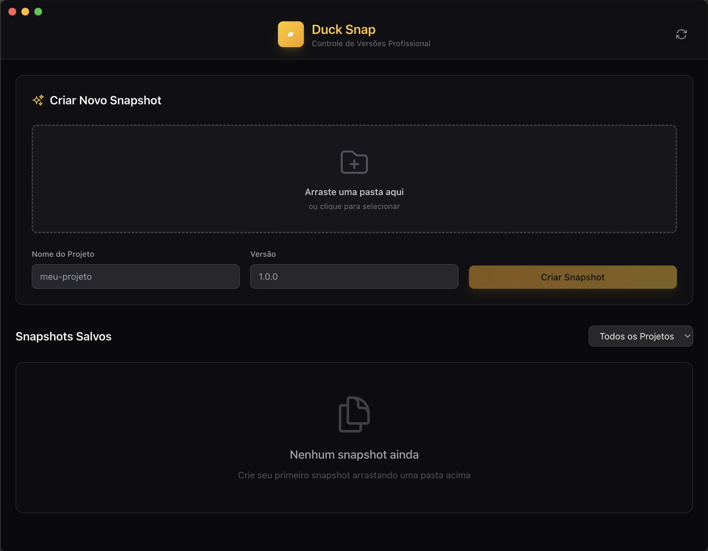

# DuckSnap

Aplicativo desktop para criar snapshots versionados de projetos locais — uma
alternativa simples ao Git para quem está no começo do projeto e ainda não quer
versionar tudo.




## O problema

No começo de um projeto, o Git cobra caro pela flexibilidade: preciso escrever
mensagem, pensar em `.gitignore`, decidir o que entra. Quem só quer voltar a
ontem à tarde não quer esse ritual — quer arrastar a pasta e ter um ponto de
retorno.

## O que faz

- **Arrastar e soltar** — arraste uma pasta para criar o snapshot na hora
- **Comparação** — veja o que mudou entre dois snapshots, em arquivos e tamanho
- **Exportação em lote** — leve todos os snapshots de um projeto de uma vez

## Decisões

**SQLite em vez de arquivos soltos.** Cada snapshot é um registro com metadados
de tamanho e contagem de arquivos, e o conteúdo vai comprimido num `.zip`
disso. Consultar "quais snapshots existem e quanto pesam" vira uma query em vez
de percorrer o disco.

**`better-sqlite3`, síncrono.** É uma API síncrona e simples, sem callback nem
pool. Num app desktop de uso local, a complexidade assíncrona não se paga.

**Electron em vez de Tauri.** O time de build é bem mais directo com Electron; a
troca por Tauri só compensaria depois de sentir o peso do pacote.

## Arquitetura

```
src/
├── main/       processo principal do Electron (janela, ciclo de vida)
├── preload/    a ponte entre main e renderer — contextIsolation ligado
├── backend/    snapshotManager: criar, listar, comparar e exportar
├── components/ Header, SnapshotCard, Notification
└── App.js      estado da interface
```

O `preload` é o único caminho entre a interface e o disco. A renderer nunca
toca em arquivo: pede, e o processo principal responde. É o que mantém
`contextIsolation` ligado sem transformar cada ação em um IPC.

## Rodar

```bash
npm install
npm run dev      # sobe o Vite e abre o Electron
npm run dist     # gera o executável para a plataforma atual
```

## Stack

| | |
| --- | --- |
| Shell | Electron |
| UI | React + Tailwind CSS |
| Persistência | SQLite via better-sqlite3 |
| Compressão | Archiver |

## Licença

MIT — [LICENSE](LICENSE).
